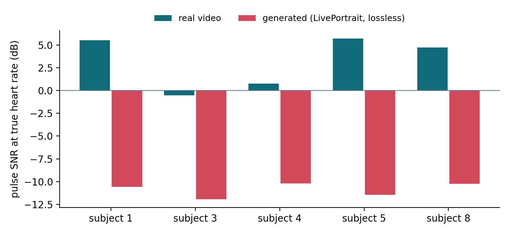
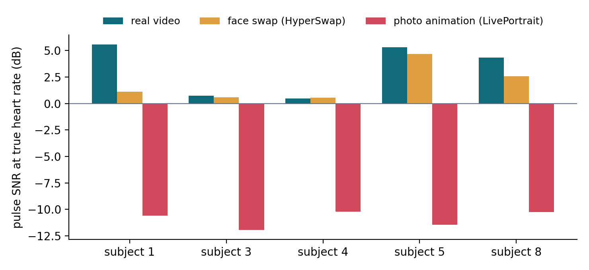

# rPPG webcam demo and pulse survival in AI-generated faces

Reads heart rate from an ordinary camera, checks the method against finger-sensor ground truth, then uses it to measure whether the pulse survives AI face generation.

Each heartbeat pushes blood into the skin and changes its colour very slightly. A camera records this as a tiny periodic colour change in the face, from which the heart rate can be computed (remote photoplethysmography, rPPG). Built in Python with OpenCV and SciPy, October 2026.

## Pipeline (`rppg_demo.py`)

1. **Face detection:** OpenCV Haar cascade on a half-size frame every 10 frames; the face box is smoothed between detections.
2. **Skin regions:** forehead and both cheeks, as fixed fractions of the face box.
3. **Colour trace:** mean R, G, B of those regions in every frame.
4. **Resampling** to a steady 30 Hz, because webcam frame timing is irregular.
5. **Pulse extraction**, three methods:
   - **POS** (Wang et al., IEEE TBME 2017), the main method: normalised RGB projected onto a plane orthogonal to skin tone, 1.6 s sliding windows with overlap-add.
   - **CHROM** (de Haan & Jeanne, IEEE TBME 2013): two chrominance signals combined per window.
   - **GREEN** (Verkruysse et al., Optics Express 2008): normalised green channel.
6. **Filtering:** 0.7–3 Hz band-pass (42–180 bpm), 3rd-order Butterworth, zero-phase.
7. **Heart rate:** strongest frequency in the band from a zero-padded FFT.
8. **Signal quality:** SNR, power at the heart rate and its first harmonic vs the rest of the band.

Engineering details:
- The live estimate is the median of the last 15 estimates.
- Tuned for a low-spec laptop: 640×480 frames, detection every 10 frames, heart rate recomputed twice a second, vectorised POS.
- The frame rate is taken from the recording's real duration, not the file header, because generators and re-encoders rewrite it (LivePortrait wrote 29.00 fps for a 29.26 fps source).

## Usage

```bash
pip install -r requirements.txt
python rppg_demo.py                          # live webcam (--camera N, --method pos|chrom|green)
python rppg_demo.py --video clip.mp4         # a video file instead of the webcam
python rppg_demo.py --eval path/to/UBFC      # score against UBFC-rPPG ground truth (10 s windows)
python rppg_demo.py --selftest               # synthetic-signal self-test
```

**Data.** UBFC-rPPG DATASET_2 (Bobbia et al., Pattern Recognition Letters 2017) is not redistributed here. Request it from its authors; `download_ubfc.py` fetches it from the public folder if Google Drive's quota allows, otherwise download it in a browser.

## Validation on UBFC-rPPG

People about 1 m from the camera, with a finger pulse sensor as ground truth. 5 of the 42 subjects (1, 3, 4, 5, 8); non-overlapping 10 s windows; heart rate computed the same way from the video and from the sensor waveform.

The ranking **POS > CHROM > GREEN** matches the published literature, which is the point of the check: it shows the implementation behaves correctly. With 5 subjects this is a sanity check, not a benchmark claim, and POS is a reimplementation of a 2017 method.

## Pilot: does the pulse survive face generation?

Full notes, including a withdrawn first analysis and its correction, are in [`pilot/RESULTS.md`](pilot/RESULTS.md).

**Compression alone can erase the pulse.** LivePortrait saves H.264 at crf 18 by default. Re-encoding the *real* video that way raised the heart-rate error from 0.4 to 37 bpm. LivePortrait was patched to save losslessly, so the test measures the generator and not the encoder.

**Photo animation (LivePortrait) loses the pulse.** Self-reenactment, lossless output, 5 subjects × 30 s:

| | Real | Generated |
|---|---|---|
| Heart-rate error (bpm) | 0.8 ± 1.0 | 39.0 ± 11.1 |
| Pulse SNR at true heart rate (dB) | +3.2 ± 2.9 | −10.9 ± 0.8 |
| Waveform match with finger sensor (r) | 0.80 ± 0.07 | 0.22 ± 0.04 |

SNR was 14 dB lower in 5 of 5 subjects (paired t-test p = 0.0003). Likely reason, not tested: LivePortrait renders skin from one still photo and transfers only motion, so the heartbeat's colour changes never carry over.



**Face swapping (FaceFusion HyperSwap) keeps the pulse, and it is the original person's.** Heart-rate error 0.4 bpm, waveform r 0.78. The pulse matches the original person rather than the face donor (r 0.78 vs 0.33, p = 0.0004): a new face carrying the old heartbeat, which is a biometric leak. Along the way: FaceFusion's lossless output is mislabelled as YUV, which scrambles colours in every decoder; it is decoded without conversion here.



## Limitations

- 5 subjects, 30 s each, from one dataset.
- Face-box skin regions only: no face landmarks or mesh, no skin segmentation.
- Classic rPPG methods only, no deep models such as PhysNet.
- The live webcam demo has not been checked against a pulse sensor.

## Layout

| Path | Purpose |
|---|---|
| `rppg_demo.py` | Live demo, evaluation and self-test |
| `download_ubfc.py` | Fetch UBFC-rPPG |
| `pilot/prepare_*.py` | Cut clips and build lossless inputs for the generators |
| `pilot/liveportrait_pilot.ipynb`, `pilot/colab_*.py` | Colab cells for LivePortrait and face-swap runs |
| `pilot/run_faceswap_local.py` | Local FaceFusion run |
| `pilot/analyze_batch.py`, `pilot/analyze_swap.py`, `pilot/simple_baselines.py` | Analysis and statistics |
| `pilot/output/*.csv`, `pilot/output/*.png` | Per-subject results and figures |

## References

- W. Wang et al., "Algorithmic Principles of Remote PPG," IEEE TBME, 2017 (POS).
- G. de Haan and V. Jeanne, "Robust Pulse Rate From Chrominance-Based rPPG," IEEE TBME, 2013 (CHROM).
- W. Verkruysse et al., "Remote plethysmographic imaging using ambient light," Optics Express, 2008.
- S. Bobbia et al., "Unsupervised skin tissue segmentation for remote photoplethysmography," Pattern Recognition Letters, 2017 (UBFC-rPPG).
- J. Guo et al., LivePortrait, 2024. FaceFusion with HyperSwap.
